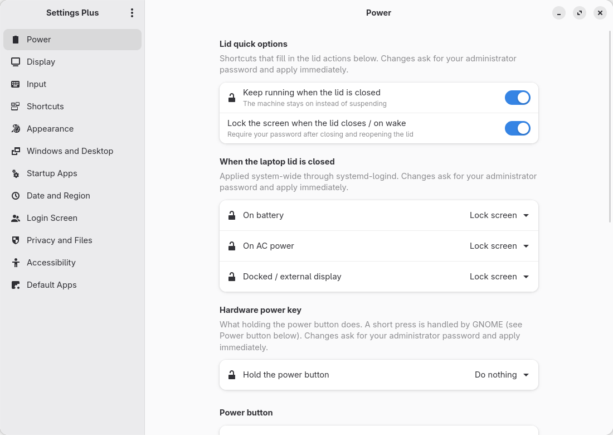
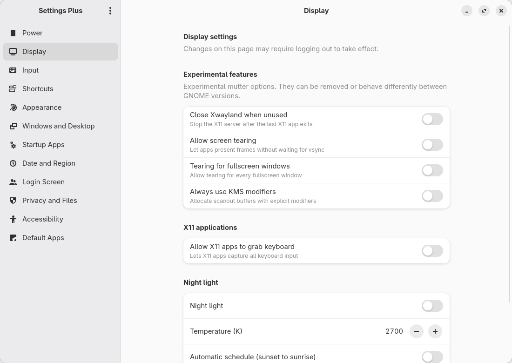
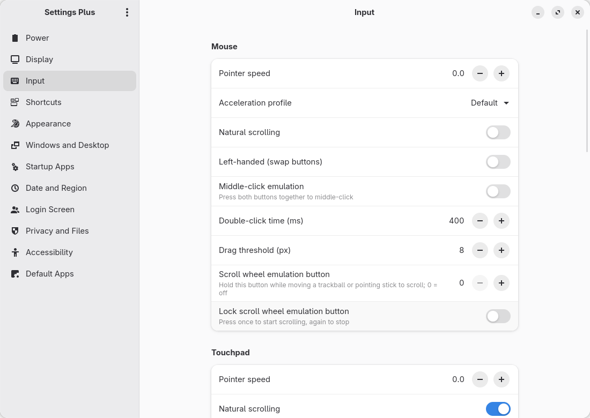
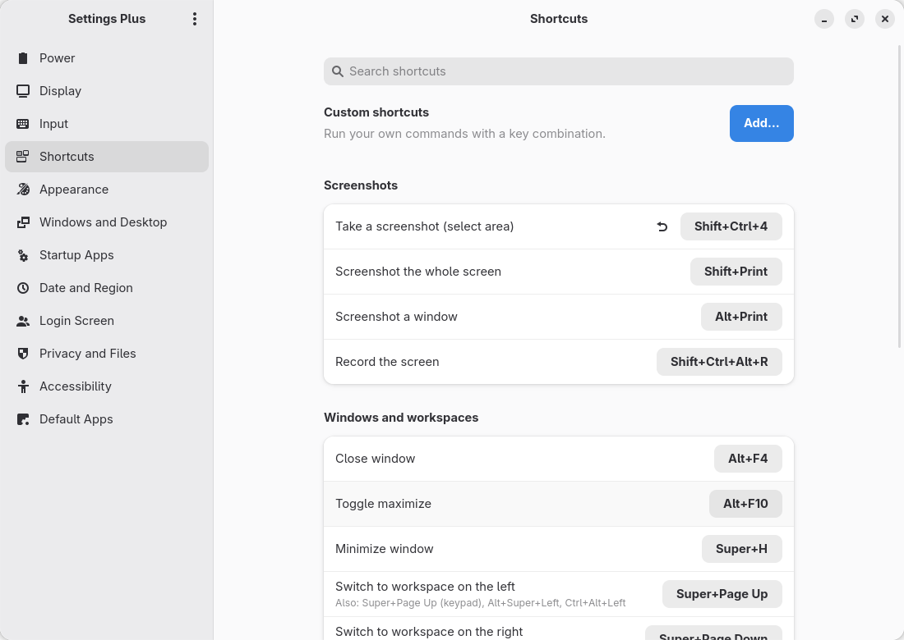
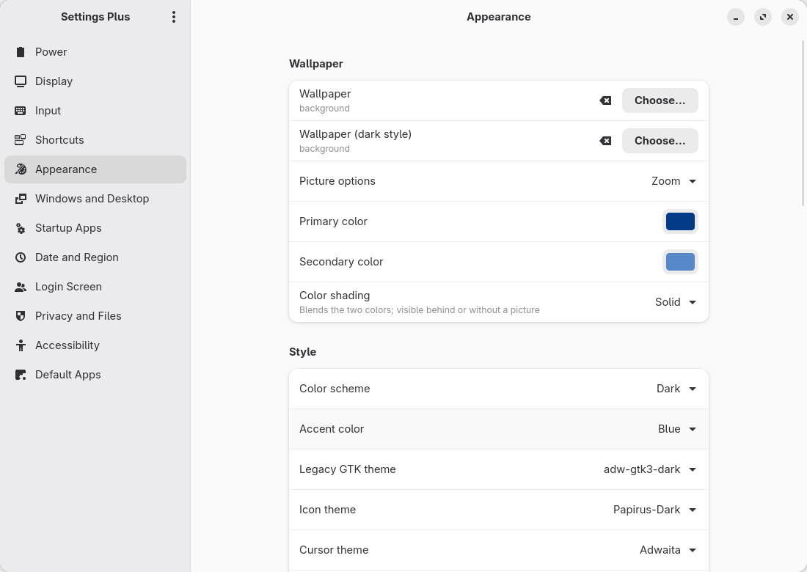
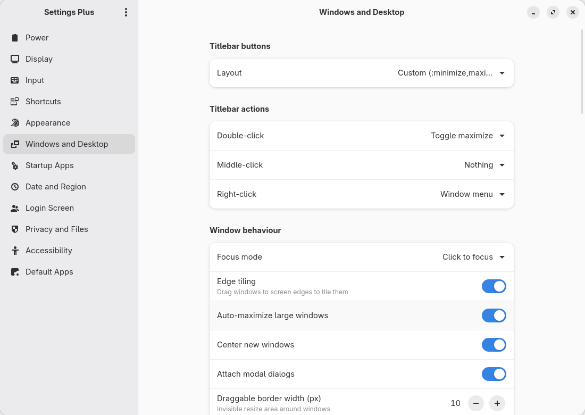
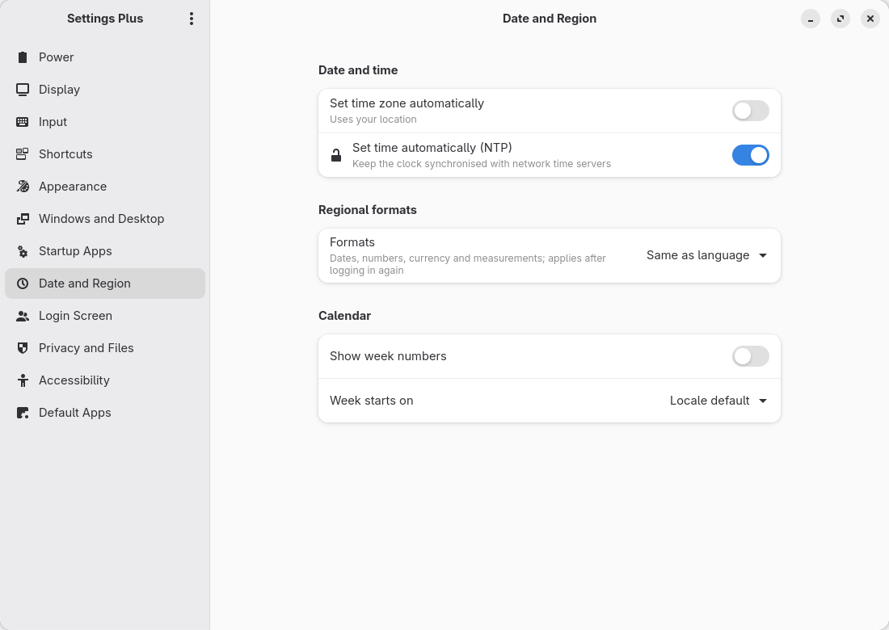
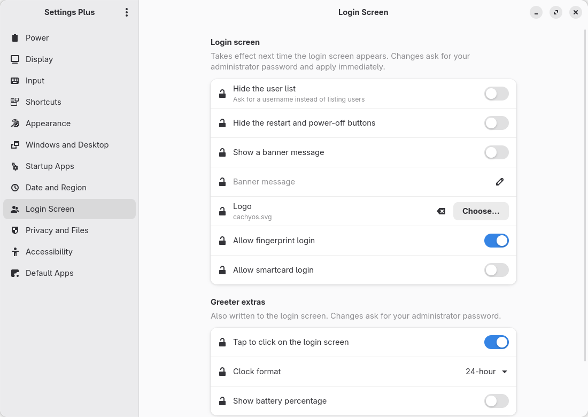
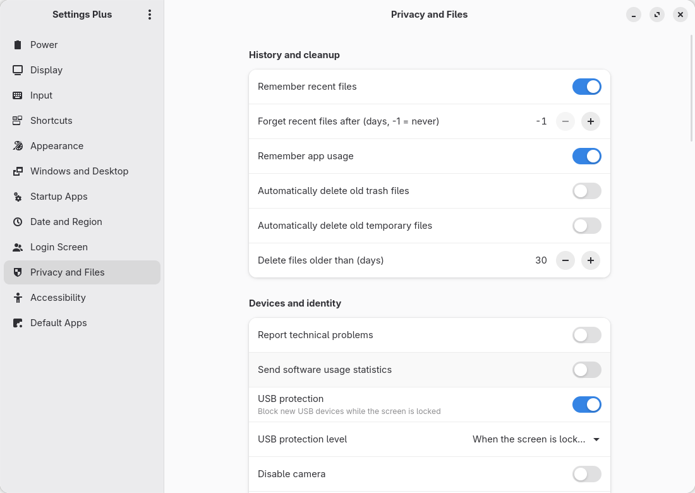
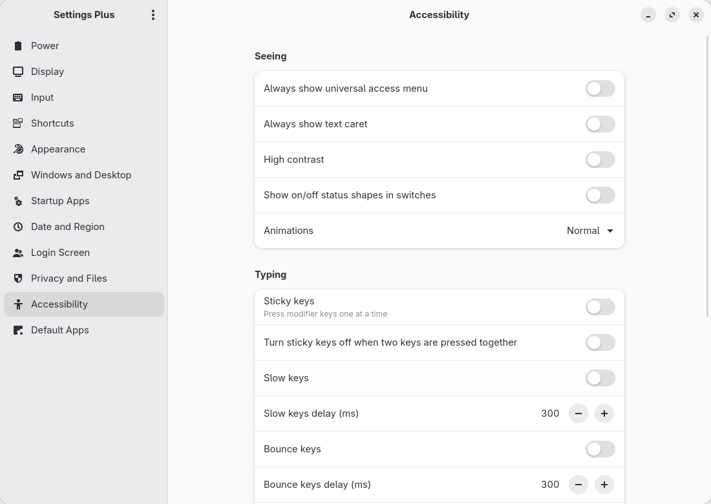

<div align="center">


# Settings Plus

**The GNOME settings that Settings and Tweaks leave out — bringing GNOME closer to KDE Plasma.**

[](https://github.com/haguilar91/SettingsPlus/actions/workflows/build.yml)
[](LICENSE)
[](https://github.com/haguilar91/SettingsPlus/releases/latest)
[](https://www.gnome.org)

<picture>
  <source media="(prefers-color-scheme: dark)" srcset="docs/screenshots/power-dark.png">
  
</picture>

</div>

## Why?

GNOME hides a lot of options that KDE System Settings puts front and centre:
what the laptop does when the lid closes, which apps start at login, what the
login screen looks like, how the touchpad behaves, how windows are focused and
tiled, and so on. Most of them exist as GSettings keys, logind options or GDM
settings, but you have to go hunting through `dconf-editor` or config files.

Settings Plus exposes them in a single libadwaita app, using only the backends
a stock GNOME install already has: GSettings, systemd-logind, GDM/dconf,
`timedatectl` and polkit. **No extensions, no patched components.** Options your
GNOME version doesn't support hide themselves, and so do groups and whole pages
that would end up empty.

## Features

Pages appear in the sidebar in this order. A 🔒 marks rows that ask for your
administrator password (through polkit) because they change system-wide
configuration.

### Power

Everything about lids, power buttons, idling and screen blanking.

- **Lid quick options**: keep running with the lid closed 🔒 and lock the screen
  on lid close / wake. These fill in the lid actions below for you.
- **When the laptop lid is closed** 🔒: separate actions on battery, on AC power
  and when docked / an external display is connected. Choices: suspend, hibernate,
  hybrid sleep, suspend-then-hibernate, lock, do nothing, power off.
- **Hardware power key** 🔒: what *holding* the power button does (nothing, power
  off, restart, suspend, hibernate, lock).
- **Power button**: what a short press does (handled by GNOME).
- **Automatic actions when idle**: action and timeout, separately for battery
  and AC; dim when idle with a configurable dimmed brightness; automatic
  brightness; power saver when the battery is low.
- **Screen blank and lock**: blank after N seconds, lock when blanked, and the
  lock delay.
- Without systemd-logind and polkit, the lid / power-key section shows a
  disabled "Requires systemd-logind and polkit" row instead.


### Display

Experimental compositor options that GNOME Settings doesn't show, plus Night Light.

- **Experimental mutter features** (only those present on your system):
  fractional scaling, variable refresh rate, native Xwayland scaling, close
  Xwayland when unused, screen tearing, tearing for fullscreen windows, KMS modifiers.
- **X11 applications**: allow X11 apps to grab the keyboard.
- **Night light**: on/off, colour temperature (1700–4700 K), automatic
  (sunset to sunrise) or manual schedule.
- Changes may need a log out to take effect. Resolution and layout are left to
  GNOME Settings.



### Input

Mouse, touchpad, pointing stick and keyboard options, including a few that GNOME hides.

<details><summary>Show details</summary>

- **Mouse**: pointer speed, acceleration profile, natural scrolling, left-handed,
  middle-click emulation, double-click time, drag threshold, scroll-wheel
  emulation button and its lock.
- **Touchpad**: pointer speed, natural scrolling, tap to click, two-finger
  scrolling, primary button, scroll speed, disable when a mouse is plugged in,
  tap button map, tap-and-drag lock, disable-while-typing timeout.
- **Pointing stick**: speed, acceleration, scroll method.
- **Keyboard**: key repeat, repeat delay and interval, Num Lock state, XKB model.
- **Input sources**: remember source per window, show all sources.
- **Key remapping**: Caps Lock as Ctrl / Esc / Backspace / disabled / swap Esc,
  Compose key, Alt/Super swap.

</details>



### Shortcuts

A full shortcut editor with live capture and conflict detection.

<details><summary>Show details</summary>

- **Search bar** that filters every group (see Highlights).
- **Custom shortcuts**: add, edit and delete your own. Pick an action from a
  searchable list of built-in GNOME actions and installed apps, or use
  **Add command instead** for any shell command.
- **Screenshots**: select area, whole screen, window, record screen.
- **Windows and workspaces**: close, maximise, minimise, move between workspaces and more.
- **System and launchers**: lock screen, log out, web browser, mail, home folder,
  calculator, search.
- A reset button appears next to built-ins you've changed, and an *Also:* line
  lists any extra bindings the action has.
- Volume step setting.

</details>

<details><summary>Screenshot</summary>



</details>

### Appearance

Look and feel, from wallpaper to sounds.

<details><summary>Show details</summary>

- **Wallpaper**: light and dark images, picture options (fit), primary and
  secondary colours, colour shading.
- **Style**: colour scheme, accent colour (all 9), legacy GTK theme, icon theme,
  cursor theme and size.
- **Fonts**: interface, document, monospace and window title fonts; text scaling
  (0.5–3); hinting, antialiasing, subpixel order.
- **Text and pointer**: cursor blink, middle-click paste.
- **Effects**: animations, overlay scrollbars, locate pointer.
- **Sound**: sound theme, event and input sounds, allow volume above 100 %,
  visual and audible bell.
- **Notifications**: banners and lock-screen notifications.

</details>

<details><summary>Screenshot</summary>



</details>

### Windows and Desktop

Window management, workspaces, session and top bar options.

<details><summary>Show details</summary>

- **Titlebar buttons**: layout presets. **Titlebar actions**: double, middle and
  right-click.
- **Window behaviour**: focus mode, edge tiling, auto-maximise, centre new
  windows, attach modal dialogs, resize border width, focus after pointer rest,
  "not responding" timeout.
- **Keys**: Activities (overview) key, locate-pointer key, move/resize modifier,
  right-button resize.
- **Alt+Tab**: windows vs. apps, thumbnails or icons, current workspace only,
  raise on click, auto-raise with delay, new-window focus.
- **Workspaces**: count, dynamic, primary monitor only, and names (up to 12).
- **Session**: always show Log Out, allow Log Out (lockdown), Log Out / Restart
  on the lock screen plus delay, Switch User, confirm logout, restore previous session.
- **Top bar**: hot corner, battery percentage, 12/24 h clock, seconds, date, weekday.
- Touchpad extras.

</details>

<details><summary>Screenshot</summary>



</details>

### Startup Apps

Manage what starts when you log in.

<details><summary>Show details</summary>

- Lists user and system autostart entries; enable or disable any of them.
- Add an installed app (searchable) or a custom command.
- Remove entries you added. System entries can only be disabled.
- No screenshot here, as the list shows your own apps.

</details>

### Date and Region

- Set time zone automatically.
- Set time automatically (NTP) 🔒 via `timedatectl`.
- Regional formats, chosen from installed UTF-8 locales (applies after logging in again).
- Calendar: week numbers and first day of the week.

<details><summary>Screenshot</summary>



</details>

### Login Screen

Only shown when GDM, dconf and polkit are available. Every row here is 🔒.

<details><summary>Show details</summary>

- Hide the user list, hide the restart and power-off buttons.
- Banner message (switch and text), login-screen logo.
- Allow fingerprint and smartcard login.
- Greeter extras: tap to click, clock format, battery percentage.
- **Reset** (with confirmation) removes the drop-in and returns to defaults.

</details>

<details><summary>Screenshot</summary>



</details>

### Privacy and Files

<details><summary>Show details</summary>

- **History and cleanup**: recent files and retention age, app usage,
  automatically delete old trash / temporary files and the age threshold.
- **Devices and identity**: disable camera, microphone, sound output; USB
  protection and level; privacy screen; hide identity; full name in the top bar;
  problem reports and usage statistics.
- **Removable media**: automount, open on insert, never autorun.
- **Files (Nautilus)**: click policy, default view, hidden files, sorting,
  recursive search, thumbnails, item counts, *Delete Permanently* and *Create
  Link* entries, zoom level, date format; file chooser options.
- **Search**: search providers and Tracker indexing options.
- **Low disk space** notification threshold.

</details>

<details><summary>Screenshot</summary>



</details>

### Accessibility

<details><summary>Show details</summary>

- **Seeing**: universal access menu, text caret, high contrast, on/off status
  shapes, reduced motion.
- **Typing**: sticky, slow, bounce, toggle and mouse keys, with their delays.
- **Pointing**: hover (dwell) click and simulated secondary click.

</details>

<details><summary>Screenshot</summary>



</details>

### Default Apps

<details><summary>Show details</summary>

Choose the default browser (http / https / html), email, text editor, video,
music, image viewer, PDF viewer and file manager. This page is hidden in the
Flatpak build, where the sandbox only sees sandboxed apps. No screenshot, as it
lists your installed apps.

</details>

## Highlights

**Instant apply, with polkit.** There is no Apply button: every change takes
effect immediately. Rows marked 🔒 call `pkexec` and ask for your administrator
password. If you cancel the prompt, the control automatically reverts to its
previous value, so the UI never shows something that isn't true.

**Live shortcut capture.** Click a shortcut and press the new keys. The editor
shows the combination as keycaps, enforces the rules for valid bindings,
treats **Esc** as cancel, **Backspace** as clear and **Enter** as confirm, and
lets Super and Alt+Tab-style combinations through so you can bind them. If the
combination is already used, the conflicting action is named and you can
**Replace** it; the replacement is applied when you save.

**Action picker.** When adding a custom shortcut you choose from a searchable
list of GNOME actions and installed applications, or choose **Add command
instead** to type any command.

**Search the Shortcuts page.** The search bar filters across all groups,
hiding groups with no matching row.

**Adaptive layout.** The window collapses from sidebar + content to a single
pane on narrow widths, so it works on small screens.

**Works on any GNOME.** Settings that your GNOME version doesn't provide
hide themselves, and empty groups and pages disappear. System-level pages need
systemd, polkit and (for the login screen) GDM, and are skipped otherwise.

## Settings Plus vs KDE Plasma

✅ covered · 🟡 partial · ❌ not possible on stock GNOME

| Area | KDE Plasma | Settings Plus |
|---|---|---|
| Lid and power button behaviour | Power Management | ✅ |
| Idle, dimming, screen lock | Power Management, Screen Locking | ✅ |
| Night light | Night Light | ✅ |
| Mouse, touchpad, TrackPoint | Input Devices | ✅ |
| Key repeat | Keyboard | ✅ |
| Shortcut editor with conflicts | Shortcuts | ✅ |
| Titlebar, focus, edge tiling | Window Management | ✅ |
| Virtual desktops | Virtual Desktops | ✅ |
| Wallpaper, colours, accent | Appearance | ✅ |
| Fonts | Fonts | ✅ |
| Sounds | Notifications and sounds | ✅ |
| Autostart | Autostart | ✅ |
| Region formats | Region & Language | ✅ |
| Accessibility | Accessibility | ✅ |
| Privacy, file manager, removable media | Recent files, Dolphin, Removable Devices | ✅ |
| Session | Session | ✅ |
| Variable refresh rate | Display | 🟡 experimental flag only |
| Keyboard layouts | Keyboard | 🟡 GNOME Settings handles layouts; remapping presets here |
| Window manager shortcuts | Shortcuts | 🟡 the built-in shortcut list |
| Hot corners | Screen Edges | 🟡 on/off only |
| Desktop effects | Desktop Effects | 🟡 animations |
| Theming | Global Theme | 🟡 GTK / icons / cursor; no shell theme |
| Notifications | Notifications | 🟡 |
| Date and time | Date & Time | 🟡 no manual date |
| Default applications | Default Applications | 🟡 8 types |
| Search indexing | File Search | 🟡 |
| Login screen | SDDM | 🟡 GDM only |
| Power profiles, battery thresholds | Power Management | ❌ |
| Display layout | Display Configuration | ❌ in GNOME Settings |
| Per-window rules | Window Rules | ❌ |
| Users and accounts | Users | ❌ in GNOME Settings |
| Network, Bluetooth, printers | Connections, Bluetooth, Printers | ❌ in GNOME Settings |

Some Plasma features can't be done on stock GNOME without extensions: window
rules, desktop widgets and icons, configurable panels, per-edge screen actions
and replacing Activities.

## Installation

### Download

Grab a build from the [latest release](https://github.com/haguilar91/SettingsPlus/releases/latest).
File names are produced by the CI workflow and contain the version number.

| Package | File | How to use |
|---|---|---|
| AppImage | `SettingsPlus-*-x86_64.AppImage` | `chmod +x` it and run it |
| Flatpak bundle | `settings-plus.flatpak` | `flatpak install --user settings-plus.flatpak` |
| Snap (classic) | `settings-plus_*.snap` | `sudo snap install --dangerous --classic settings-plus_*.snap` |
| Standalone executable | `settings-plus` | `chmod +x` and run; needs PyGObject installed |
| Source tarball | `SettingsPlus-*.tar.gz` | extract, then run `./install.sh` |

**About sandboxing.** Because Settings Plus changes system settings (dconf,
`/etc`, polkit), the Flatpak requests broad host access and the Snap uses
classic confinement. The AppImage and the standalone executable use your
system's GTK 4, libadwaita and PyGObject.

### From source

Requirements:

- GNOME 46 or newer, libadwaita ≥ 1.5, GTK ≥ 4.10, PyGObject
- Optional: systemd-logind and polkit (lid / power key), GDM and dconf (login
  screen), Nautilus, Tracker, `gtk-launch`, GnomeDesktop typelib (nicer locale names)

PyGObject packages: Arch `python-gobject`, Fedora `python3-gobject`,
Debian/Ubuntu `python3-gi gir1.2-adw-1`.

```sh
git clone https://github.com/haguilar91/SettingsPlus.git
cd SettingsPlus
./install.sh        # install for your user
./uninstall.sh      # remove it again
```

To run without installing:

```sh
/usr/bin/python3 settings_plus.py
```

## How it works / safety

**User settings** are stored in GSettings, the same place GNOME Settings and
Tweaks use, so nothing here is proprietary. You can undo any of them with
`gsettings reset <schema> <key>`.

**System settings** are written through `pkexec` (polkit), and only to files
that Settings Plus owns:

| Feature | File | Undo |
|---|---|---|
| Lid and power key | `/etc/systemd/logind.conf.d/50-settings-plus.conf` | delete the file, then `sudo systemctl kill -s HUP systemd-logind` |
| Login screen | `/etc/dconf/db/gdm.d/50-settings-plus` (and a `gdm` dconf profile if missing) | delete the file, then `sudo dconf update` |
| NTP | `timedatectl set-ntp` | `timedatectl set-ntp true` / `false` |

Set `SETTINGS_PLUS_DEBUG=1` to see what the app is doing when you run it from a terminal.

## Building packages

The [Makefile](Makefile) has targets `make zipapp`, `make tarball`,
`make appimage`, `make flatpak` and `make snap`. The
[GitHub Actions workflow](.github/workflows/build.yml) builds all of them on
every push and attaches them to the release for tags matching `v*`.

Screenshots in `docs/screenshots/` are generated with
`/usr/bin/python3 tools/screenshots.py`, which renders the app's own window
offscreen without changing any setting.

## Contributing

Issues and pull requests are welcome at
[github.com/haguilar91/SettingsPlus](https://github.com/haguilar91/SettingsPlus).
The whole app lives in `settings_plus.py`. Please only add options that work
with stock GNOME components and hide themselves when unsupported.

## Author

Hector Aguilar ([@haguilar91](https://github.com/haguilar91)). Built with AI
assistance from Claude (Anthropic).

## License

GPL-3.0-or-later. See [LICENSE](LICENSE).
